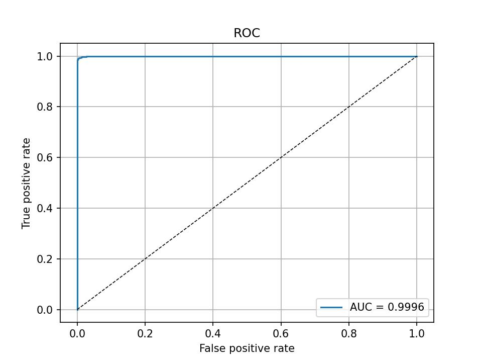
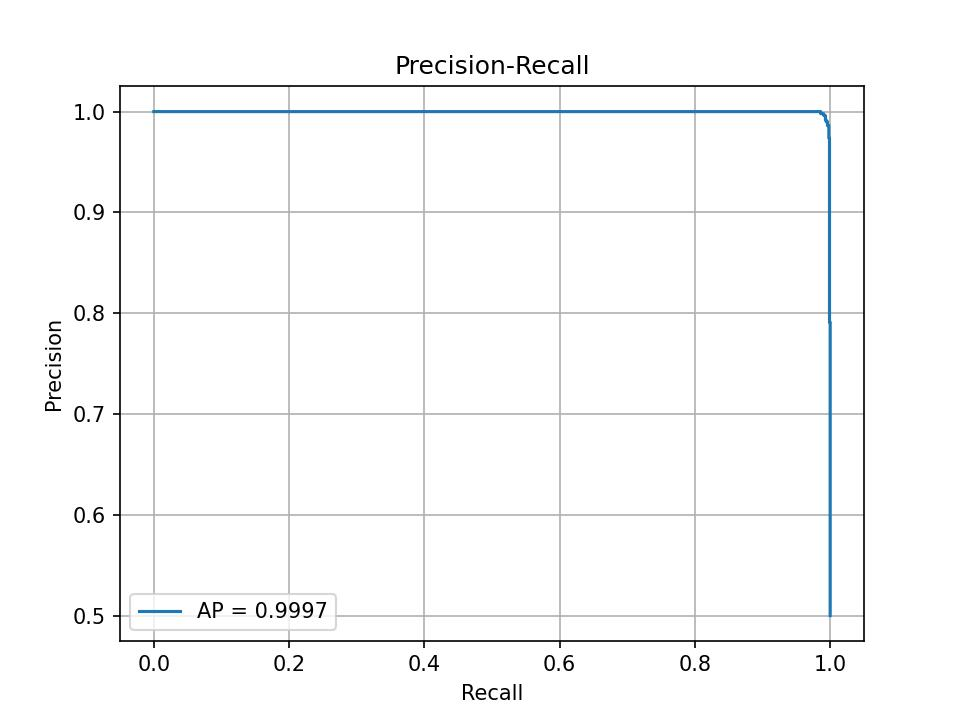
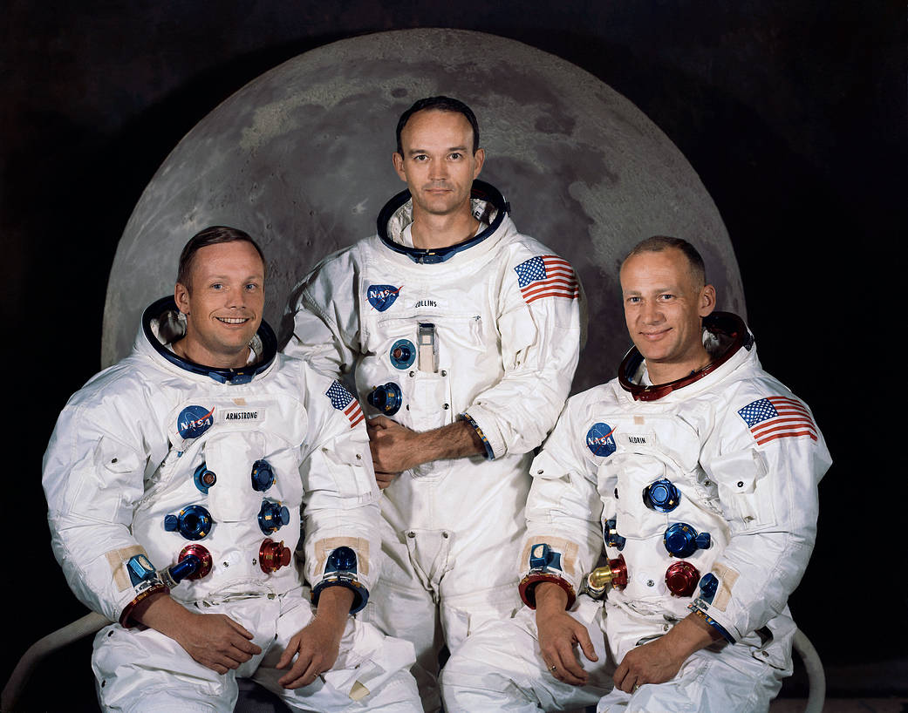
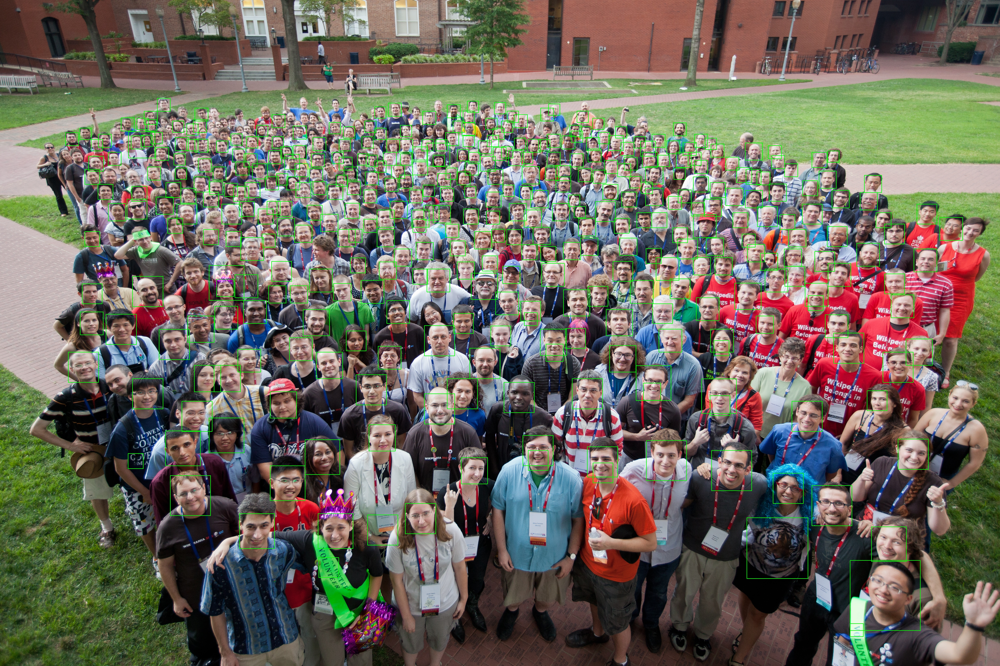
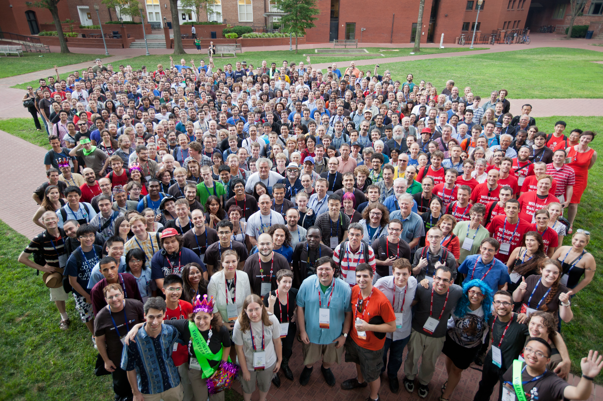

# Face Detection with HOG and SVM

This project detects faces in images of any size using Histogram of Oriented Gradients (HOG) features and a Support Vector Machine (SVM). The classifier is trained on 64×64 face and non-face patches and then applied to full images with a multi-scale sliding window.

## Method

Positive samples are the original (not aligned) LFW images. A fixed border is cropped from each one to remove most of the background, and the result is resized to 64×64 grayscale. Negative samples are random 64×64 patches, taken at random scales, from face-free images (ADE20K and Caltech, excluding any "faces" category). The negative source images are split 80/10/10 into train, validation and test sets before patches are cropped, so no source image appears in more than one split. Each split has 10,000 / 1,000 / 1,000 faces and the same number of non-faces.

HOG parameters (cell size, block size and block stride) are compared on the validation set with a fast linear SVM, and the best setting is kept. Several SVMs are then trained on those features, including linear SVMs with different `C`, RBF SVMs with different `C` and `gamma`, and a polynomial kernel, and the one with the highest validation accuracy is selected. The model is then improved with one round of hard-negative mining. The detector runs on face-free training images, and the windows it wrongly accepts are added to the negative set before retraining.

To detect faces in a new image, the image is converted to grayscale and rescaled repeatedly by a factor of 1.15 to form an image pyramid. A 64×64 window slides over each level with a stride of 8 pixels, and all windows of a level are scored together with the SVM decision function. Windows above a score threshold are mapped back to original image coordinates and merged with score-based non-maximum suppression (IoU 0.3), keeping the highest-scoring box in each cluster.

Selected parameters: HOG cell 8×8, block 32×32, block stride 8×8, 9 bins (3600 features per window). In the run with the RBF search, the best classifier was an RBF SVM with C = 1 and gamma = 0.0757.

## Results

Validation accuracy of the HOG settings (linear SVM, C = 0.1):

| Cell        | Block        | Stride      | Features       | Val. accuracy    |
| ----------- | ------------ | ----------- | -------------- | ---------------- |
| 8           | 16           | 8           | 1764           | 0.9970           |
| **8** | **32** | **8** | **3600** | **0.9980** |
| 16          | 32           | 16          | 324            | 0.9945           |
| 4           | 8            | 4           | 8100           | 0.9965           |

Classifier comparison on the 8/32/8 features:

| Model                                     | Val. accuracy    | Test accuracy    | AP               | AUC              |
| ----------------------------------------- | ---------------- | ---------------- | ---------------- | ---------------- |
| Linear SVM (C = 0.1)                      | 0.9975           | 0.9940           | 0.9997           | 0.9996           |
| **RBF SVM (C = 1, gamma = 0.0757)** | **0.9995** | **0.9955** | **0.9998** | **0.9998** |

Accuracies are after hard-negative mining. The RBF run collected 104 hard negatives and the linear run collected 487.

<table>
  <tr>
    <td align="center">ROC Curve</td>
    <td align="center">Precision-Recall Curve</td>
  </tr>
  <tr>
    <td></td>
    <td></td>
  </tr>
</table>

<table>
  <tr>
    <td align="center">Original Image</td>
    <td align="center">Detected Faces</td>
  </tr>
  <tr>
    <td></td>
    <td></td>
  </tr>
    <tr>
    <td></td>
    <td></td>
  </tr>
</table>
