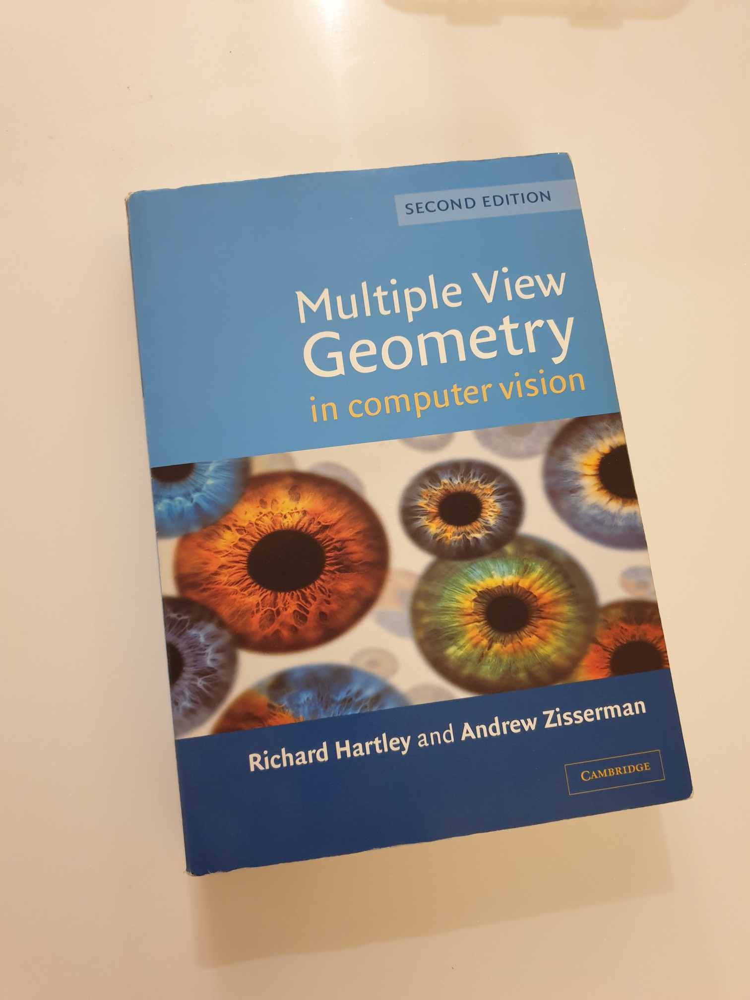
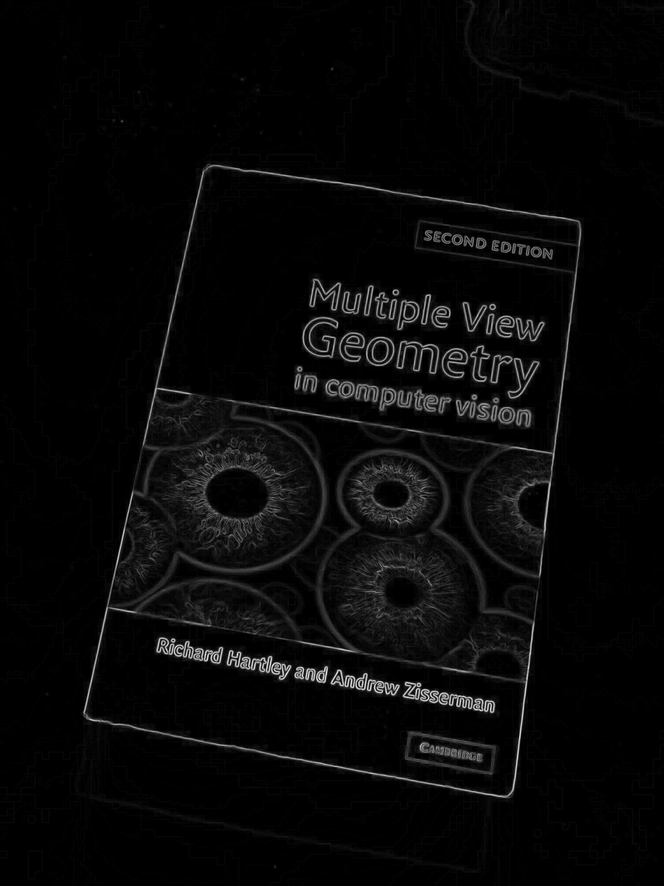
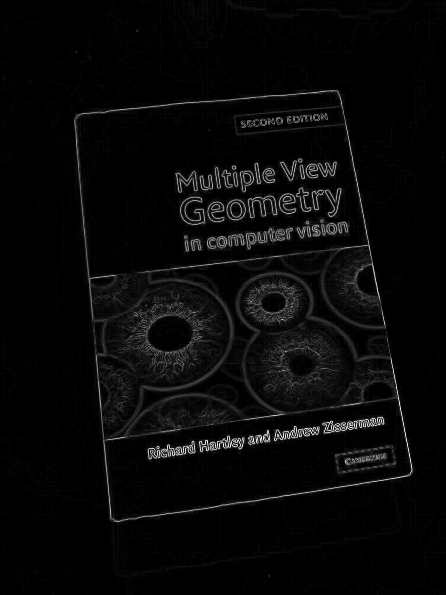
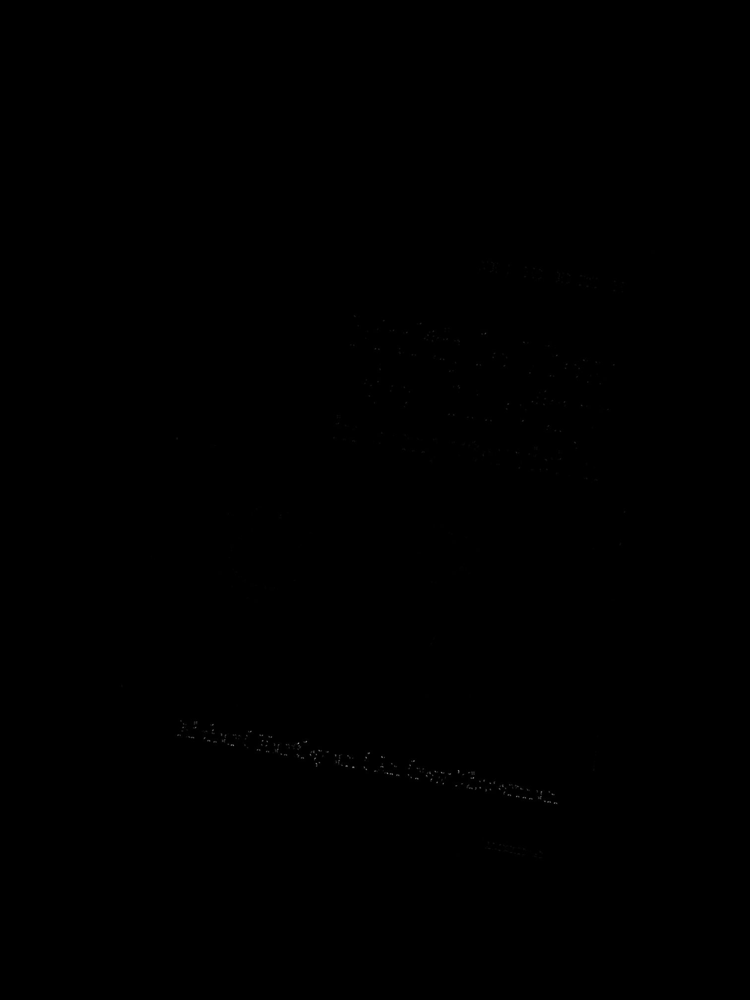
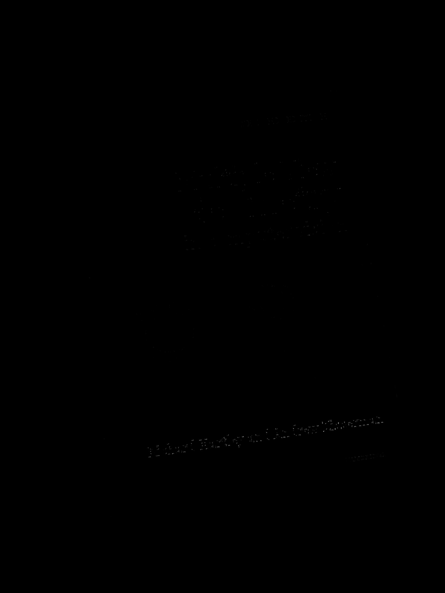
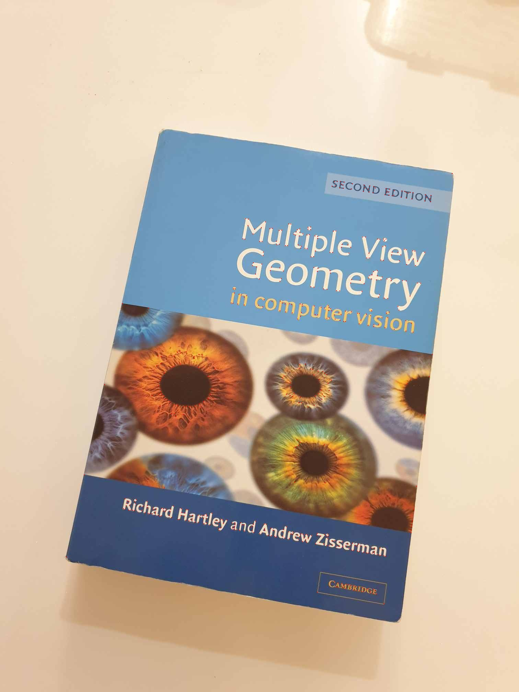
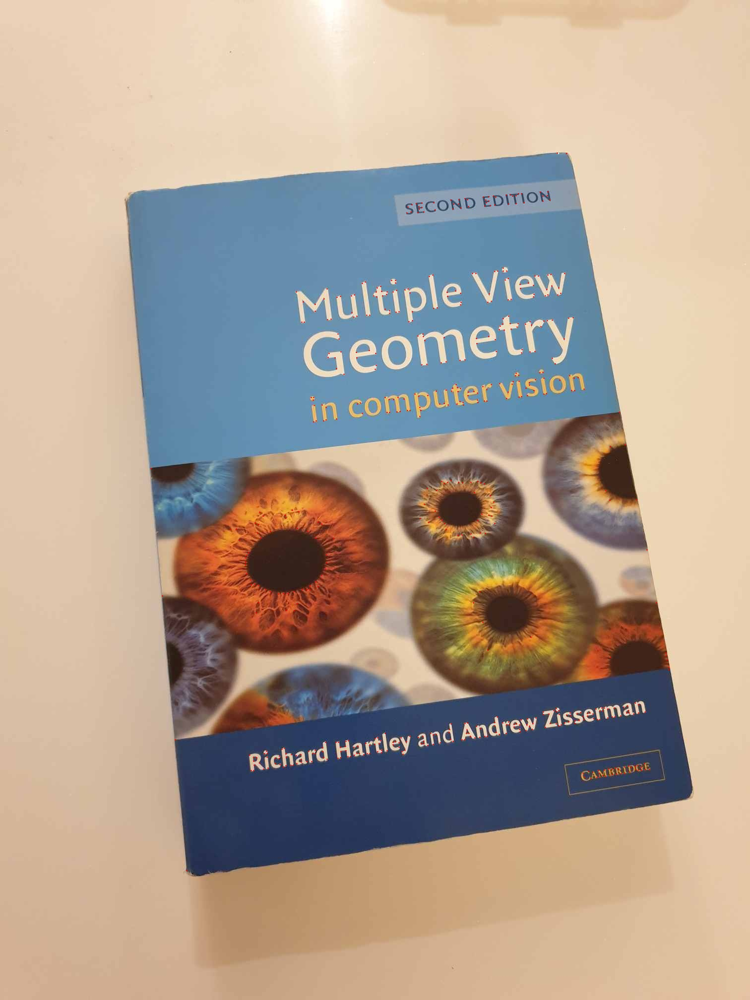
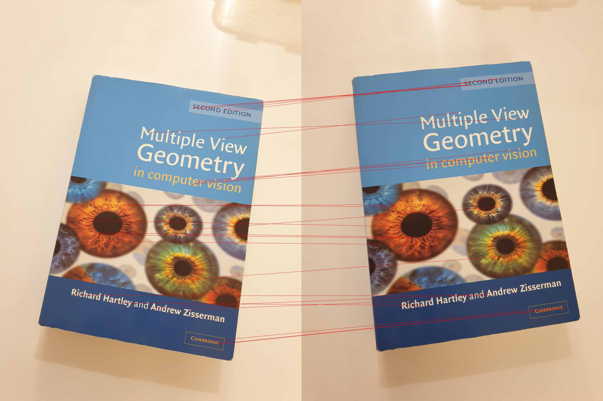

# Harris Corner Detection and Feature Matching

This project focuses on detecting and matching key points (corners) between two images using the Harris Corner Detection method. It involves computing the gradients of the images, applying Gaussian filtering, and calculating the Harris corner response to identify significant points of interest. Non-Maximum Suppression (NMS) is used to refine the detection by eliminating weak or redundant points. The detected corners are then described using feature vectors, and matching points between the two images are found by comparing these vectors using L1 or L2 distance metrics. The final result is a set of matched corresponding points between the two images, which can be used for tasks like object recognition and image stitching.

## Method

The following steps are followed to perform Harris corner detection and feature matching:

1. **Gradient Calculation:**

   1. For each pixel, compute the gradient in the horizontal $I_x$ and vertical $I_y$ directions using Sobel filters.
   2. Calculate the gradient magnitude at each pixel using the formula:$\text{Gradient Magnitude} = \sqrt{I_x^2 + I_y^2}$
2. **Gaussian Filtering:**

   1. Apply Gaussian filtering on the squared gradients and the cross-product of the gradients to smooth the images and reduce noise.
   2. Compute the Structure Tensor for each pixel:

      $$
      S = \begin{bmatrix}
      S_x^2 & S_{xy} \\
      S_{xy} & S_y^2
      \end{bmatrix}
      $$

      Where $S_x^2 = I_x^2$, $S_y^2 = I_y^2$, $S_{xy} = I_x I_y$.
3. **Harris Corner Response:**

   Compute the Harris response $R$ at each pixel using the determinant and trace of the structure tensor:

   $$
   R = \text{det}(S) - k \cdot (\text{trace}(S))^2
   $$
4. **Thresholding and NMS:**

   1. Apply thresholding to the Harris response matrix to remove weak corners and retain only strong ones.
   2. Apply Non-Maximum Suppression (NMS) to eliminate redundant corners and keep only the most significant points in each neighborhood.
5. **Feature Matching:**

   1. Extract SIFT descriptors around each corner point.
   2. Use either L1 or L2 distance to compare the feature vectors between the two images.
   3. Match corresponding points from both images based on the feature vector similarity.

## Result

<table>
  <tr>
    <td align="center">Original Image 1</td>
    <td align="center">Original Image 2</td>
  </tr>
  <tr>
    <td></td>
    <td></td>
  </tr>
  <tr>
    <td align="center">Gradient Magnitude of Image 1</td>
    <td align="center">Gradient Magnitude of Image 2</td>
  </tr>
  <tr>
    <td></td>
    <td></td>
  </tr>
  <tr>
    <td align="center">Harris Corner Response Image 1</td>
    <td align="center">Harris Corner Response Image 2</td>
  </tr>
  <tr>
    <td></td>
    <td></td>
  </tr>
  <tr>
    <td align="center">Thresholded Harris Corner Response (Image 1)</td>
    <td align="center">Thresholded Harris Corner Response (Image 2)</td>
  </tr>
  <tr>
    <td></td>
    <td></td>
  </tr>
  <tr>
    <td align="center">Harris Corners Detected (Image 1)</td>
    <td align="center">Harris Corners Detected (Image 2)</td>
  </tr>
  <tr>
    <td></td>
    <td></td>
  </tr>
  <tr>
    <td align="center">Final Result</td>
  </tr>
  <tr>
    <td colspan="2" align="center"></td>
  </tr>
</table>
