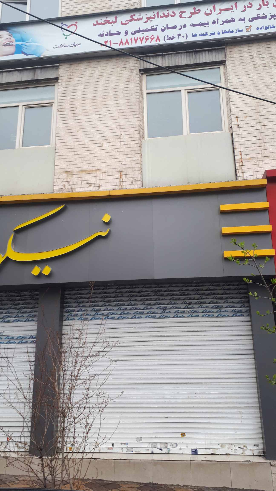
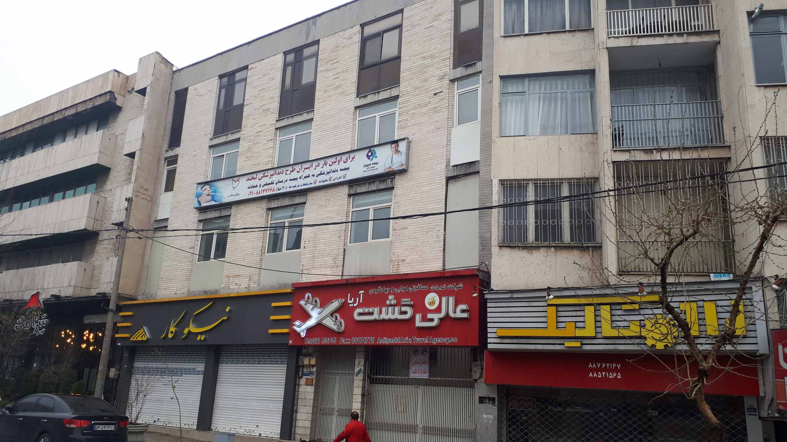
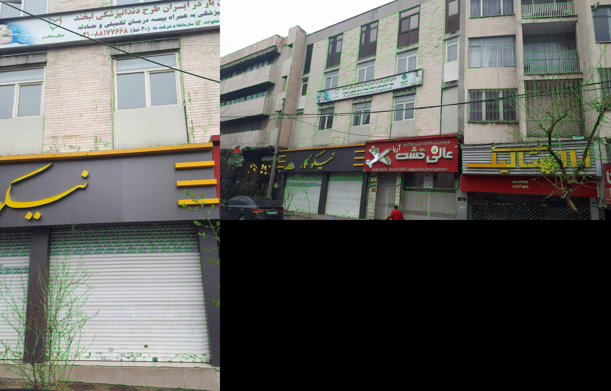
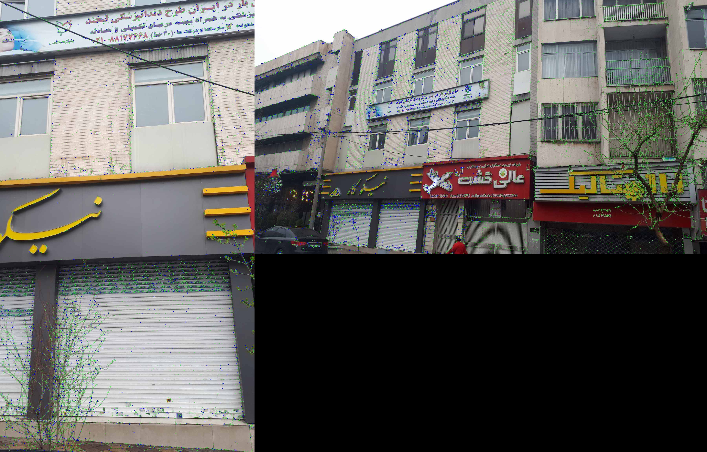
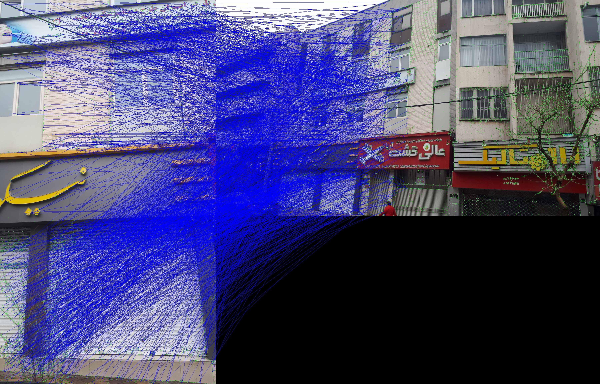
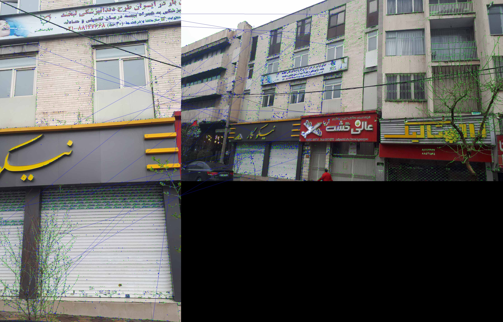
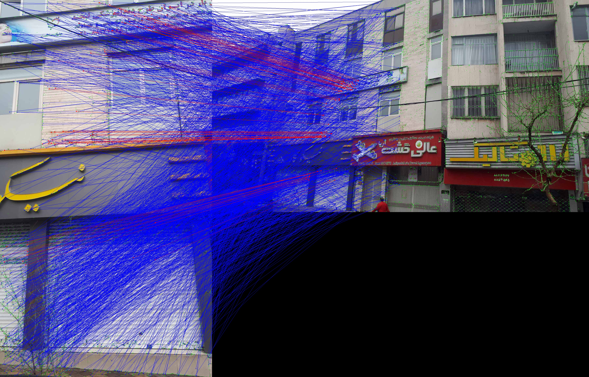
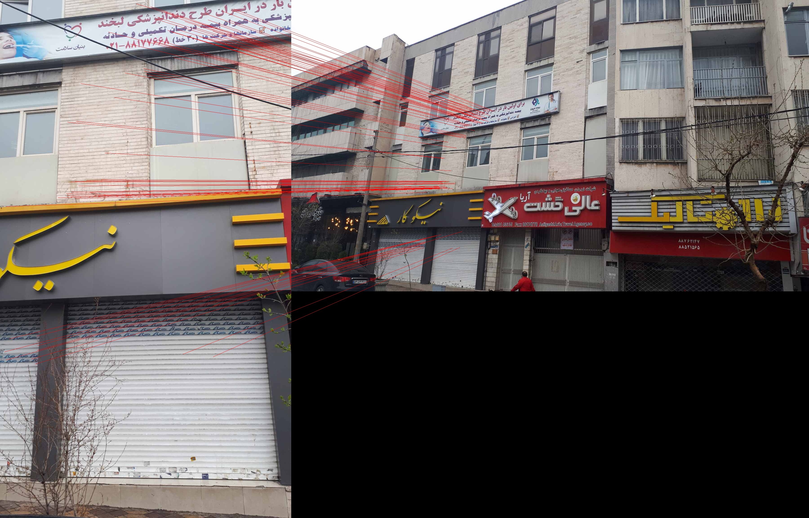
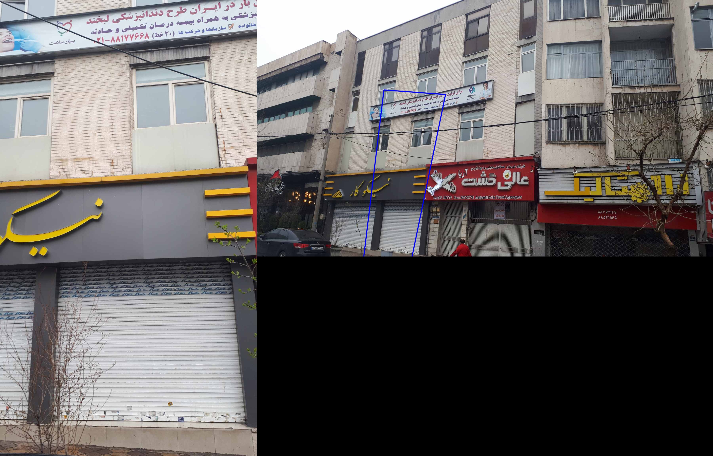

# Image Homography Estimation

This project involves using **SIFT** (Scale-Invariant Feature Transform) and **RANSAC** (RANdom SAmple Consensus) to estimate a **homography** matrix between two images. The task is to compute the transformation required to align the second image with the first image's viewpoint.

## Method

1. **Keypoint Detection with SIFT:** We begin by detecting keypoints in both images using  SIFT , which identifies distinctive points that are invariant to scale, rotation, and to some extent, viewpoint changes.
2. **Feature Matching:** Next, we match the descriptors from both images using  Brute-Force Matcher (BFMatcher) . The matches are based on the similarity of the descriptors.
3. **RANSAC to Filter Matches:** RANSAC is used to handle incorrect or noisy matches by robustly estimating the homography matrix. The algorithm begins by randomly selecting a minimal subset of matches, typically the smallest number required to compute the homography. It then calculates the homography matrix for this subset and evaluates how well it fits all other matches. Matches that are geometrically consistent with the homography are considered  inliers , while others are classified as  outliers . RANSAC repeats this process multiple times, each time selecting a new subset and recalculating the homography, ultimately choosing the model that has the largest number of inliers.
4. **Homography Matrix Estimation:** After filtering the inliers, we estimate the homography matrix ($H$) using the inlier matches that maps points from the second image to the first image.
   $$
   H = \begin{bmatrix}
   3.72217888 & 0.450418453 & -2595.07822 \\
   -0.138959851 & 1.85862397 & -755.636302 \\
   0.0000200341994 & -0.000242036157 & 1
   \end{bmatrix}
   $$
5. **Warping the Second Image:** Once the homography matrix is computed, we use perspective transformation to apply the homography to the second image. This warps the second image so that it aligns with the first image’s viewpoint.

## Result

<table>
  <tr>
    <td align="center">Original Image 1</td>
    <td align="center">Original Image 2</td>
  </tr>
  <tr>
    <td></td>
    <td></td>
  </tr>
</table>

<table>
  <tr>
    <td align="center">SIFT Keypoints</td>
  </tr>
  <tr>
    <td></td>
  </tr>
  <tr>
    <td align="center">Corresponding Points</td>
  </tr>
  <tr>
    <td></td>
  </tr>
  <tr>
    <td align="center">All Matched Feature Pairs</td>
  </tr>
  <tr>
    <td></td>
  </tr>
  <tr>
    <td align="center">Random Subset of Matches</td>
  </tr>
  <tr>
    <td></td>
  </tr>
  <tr>
    <td align="center">RANSAC Inliers</td>
  </tr>
  <tr>
    <td></td>
  </tr>
  <tr>
    <td align="center">RANSAC Inliers</td>
  </tr>
  <tr>
    <td></td>
  </tr>
  <tr>
    <td align="center">Example of Mismatched Correspondences</td>
  </tr>
  <tr>
    <td></td>
  </tr>
  <tr>
    <td align="center">Projected Corners of Image 1 onto Image 2</td>
  </tr>
  <tr>
    <td></td>
  </tr>
</table>

<table>
  <tr>
    <td align="center">Warped image</td>
  </tr>
  <tr>
    <td></td>
  </tr>
  <tr>
    <td align="center">comparison of the original image and the warped image</td>
  </tr>
  <tr>
    <td></td>
  </tr>
</table>
