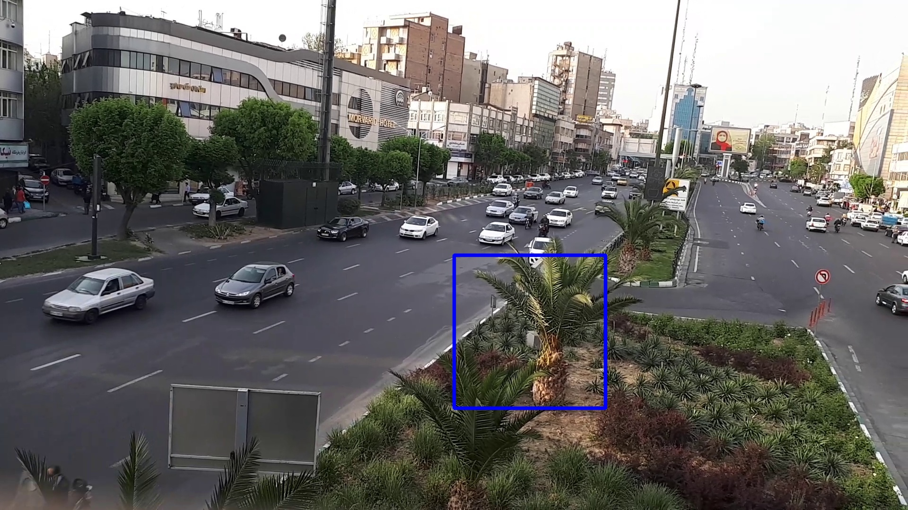
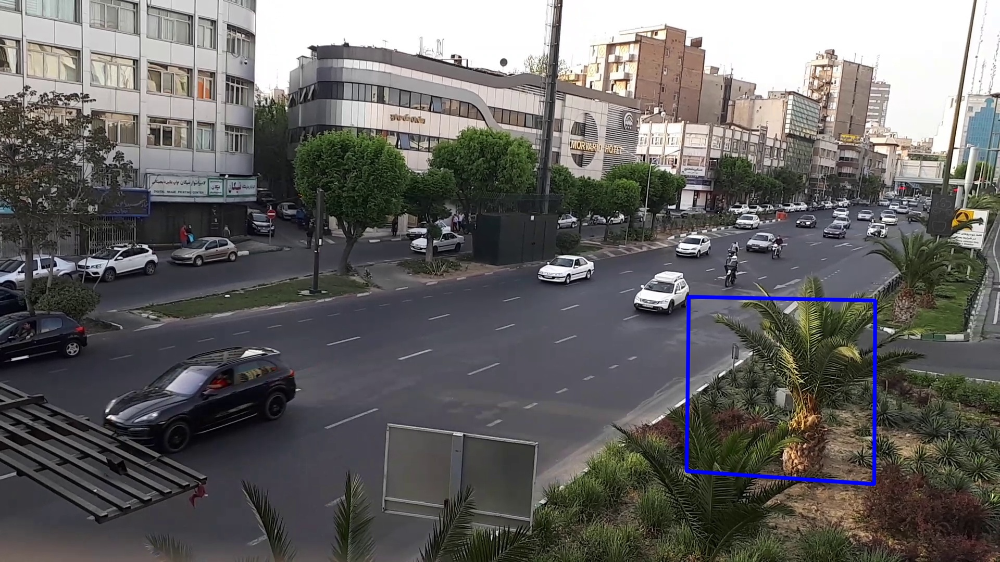

# Video Panorama and Foreground/Background Extraction

This project implements a pipeline for processing a video recorded from a busy street in Tehran. The goal is to construct a panoramic representation of the scene, separate the static background from moving foreground objects, and generate stabilized and wider-view videos.

## Method

The project implements a multi-stage video processing pipeline using OpenCV. First, the input video is sampled into 900 frames. SIFT features are then extracted from selected key frames, and FLANN-based feature matching with Lowe's ratio test is used to estimate homographies between frames. These homographies map all frames onto a common reference plane, producing aligned warped frames and a panoramic representation of the scene.

To construct the panorama, key frames are combined using distance-based weighted blending. Pixels closer to the center of each frame receive higher weights, which helps reduce visible seams in overlapping regions. The resulting panorama is used as a representation of the static scene.

Next, the static background is estimated using a temporal median of nearby aligned panorama frames. Moving objects appear only temporarily at a given location, so the median operation suppresses them while preserving the static scene. Manually defined masks are also used around regions where moving objects or boundaries require special handling. The estimated background is then projected back into the original camera viewpoint for every frame.

Foreground regions are extracted by comparing each original frame with its corresponding estimated background. Pixels with sufficiently large color differences are considered foreground and highlighted in the output video.

The pipeline also generates a wider background video by projecting an expanded region of the panorama back into each frame. Finally, camera motion is reduced through video stabilization: SIFT features are matched between consecutive frames, a 2D rotation transformation is estimated using SVD, and the transformation is accumulated to produce a stabilized, shakeless video.

## Results

<table>
  <tr>
    <td align="center">Reference Frame</td>
    <td align="center">Mapped Region</td>
    <td align="center">Two-Frame Panorama Stitching</td>
  </tr>
  <tr>
    <td></td>
    <td></td>
    <td></td>
  </tr>
</table>

<table>
  <tr>
    <td align="center">Key-Frame Panorama</td>
    <td align="center">Background Panorama</td>
  </tr>
  <tr>
    <td></td>
    <td></td>
  </tr>
