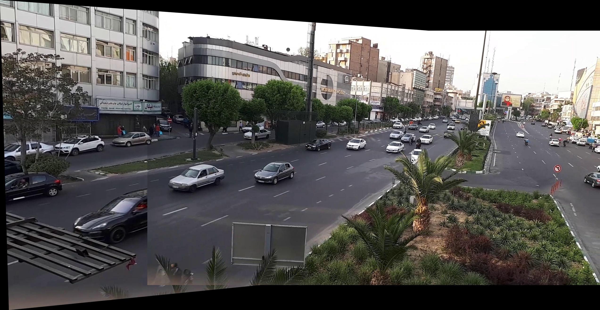
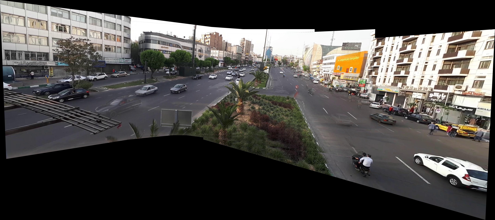
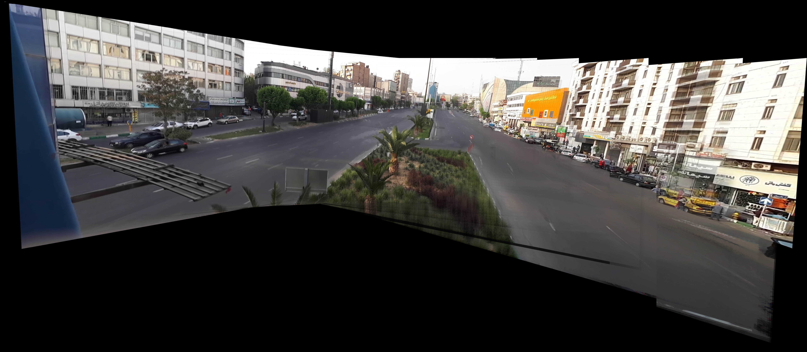

# Computer-Vision-Assignments-2022

This repository contains my university computer vision projects, covering feature detection and matching, multi-view geometry, panoramas, and recognition with both classical and neural-network methods.

Each project has its own folder and README with the method and full results. Below are some of my favorites.

## Highlights

### Video Panorama and Foreground/Background Extraction

Aligns the frames of a street video with SIFT homographies, blends key frames into a panorama, recovers the static background with a temporal median, extracts moving foreground objects, and stabilizes the video.

<table>
  <tr>
    <td align="center">Two-Frame Panorama</td>
    <td align="center">Key-Frame Panorama</td>
    <td align="center">Background Panorama</td>
  </tr>
  <tr>
    <td></td>
    <td></td>
    <td></td>
  </tr>
</table>

[Full project →](./Panorama)

### Face Detection (HOG + SVM)

Detects faces of any size by scoring a multi-scale sliding window with an RBF SVM on HOG features, trained with hard-negative mining and merged with score-based non-maximum suppression. Reaches 99.55% test accuracy on 64×64 patches.

<table>
  <tr>
    <td align="center">Original Image</td>
    <td align="center">Detected Faces</td>
  </tr>
  <tr>
    <td></td>
    <td></td>
  </tr>
</table>

[Full project →](<./Face Detection Using HOG and SVM>)

### Harris Corner Detection and Feature Matching

Computes the Harris response from a Gaussian-smoothed structure tensor, keeps strong corners with thresholding and non-maximum suppression, and matches them between two images using SIFT descriptors.

<table>
  <tr>
    <td align="center">Harris Corners (Image 1)</td>
    <td align="center">Harris Corners (Image 2)</td>
  </tr>
  <tr>
    <td></td>
    <td></td>
  </tr>
  <tr>
    <td colspan="2" align="center"></td>
  </tr>
</table>

[Full project →](<./Harris Corner Detection and Matching>)

## All Projects

- **Features and matching:** [Harris Corner Detection](<./Harris Corner Detection and Matching>), [Image Homography Estimation](./Homography), [Epipolar Geometry](<./Epipolar Geometry>)
- **Camera geometry and panoramas:** [Vanishing Points and Lines](<./Vanishing Points and Lines>), [Perspective Warping](./Perspective), [Video Panorama](./Panorama)
- **Detection and recognition:** [Face Detection (HOG + SVM)](<./Face Detection Using HOG and SVM>), [Scene Recognition (Bag of Words)](<./Scene Recognition Using Bag of Words>), [Scene Recognition (Neural Networks)](<./Scene Recognition Using AlexNet and Transfer Learning>)
