# Scene Recognition Using Neural Networks

This project classifies scene images into 15 categories using AlexNet-based neural networks in PyTorch. Five setups are compared: three networks trained from random initialization (of increasing depth) and two that reuse an AlexNet pretrained on ImageNet, one with only its last layer trained and one fully fine-tuned.

## Method

The experiments use the [Scene-15-Raw dataset](https://www.kaggle.com/datasets/yiklunchow/scene15/versions/1), which contains scene images from 15 categories. Training images are augmented with random cropping, horizontal flips, small rotations, small perspective changes, and slight brightness and contrast jitter. Test images are only resized and center-cropped, and all inputs are normalized with ImageNet statistics.

The five experiments are:

1. **Experiment 1:** the first AlexNet conv layer (with 4×4 max pooling, stride 4) followed by the last two fully connected layers, randomly initialized.
2. **Experiment 2:** the first three conv layers followed by three fully connected layers, randomly initialized. The third conv layer has 256 filters instead of 384, and a 2×2 max pooling with stride 2 is added after it so that its output size matches the fifth layer of AlexNet.
3. **Experiment 3:** the full AlexNet architecture, randomly initialized.
4. **Experiment 4:** the full AlexNet with the first 7 layers copied from the ImageNet-pretrained model and frozen. Only the new randomly initialized last layer (4096 to 15) is trained (transfer learning).
5. **Experiment 5:** the same as experiment 4, but all layers are updated with a small learning rate (fine tuning).

All models are trained for 30 epochs with SGD (momentum 0.9, weight decay 5e-4) and a `ReduceLROnPlateau` scheduler driven by the test loss. The learning rate is 0.01 for experiments 1 to 4 and 0.001 for experiment 5. Experiments 1 to 3 use 112×112 crops (resized to 128), and experiments 4 and 5 use the standard 224×224 crops (resized to 256). Loss and top-1/top-5 accuracy are recorded for both train and test data at the initial weights (epoch 0) and after every epoch.

## Results

| Experiment | Setup                       | Best Test Top-1 | Best Test Top-5 |  Min Test Loss  |
| :--------: | --------------------------- | :--------------: | :--------------: | :--------------: |
|     1     | conv1 + 2 FC, random init   |      57.60%      |      91.87%      |      1.3400      |
|     2     | conv1-3 + 3 FC, random init |      64.87%      |      95.40%      |      1.0753      |
|     3     | Full AlexNet, random init   |      55.53%      |      92.07%      |      1.4014      |
|     4     | Pretrained, last layer only |      87.40%      |      99.80%      |      0.5041      |
|     5     | Pretrained, fine tuning     | **90.33%** | **99.93%** | **0.3161** |

With only a small training set, the pretrained networks are far better than the ones trained from scratch. Fine tuning (experiment 5) improves on training only the last layer (experiment 4) by about 3 points in top-1 accuracy. Among the randomly initialized networks, the medium-sized network (experiment 2) beats both the very small one and the full AlexNet, which has too many parameters for this amount of data and was still improving at the end of training.

### Experiment 1: conv1 + 2 FC

<table>
  <tr>
    <td align="center">Loss</td>
    <td align="center">Top-1 Accuracy</td>
    <td align="center">Top-5 Accuracy</td>
  </tr>
  <tr>
    <td>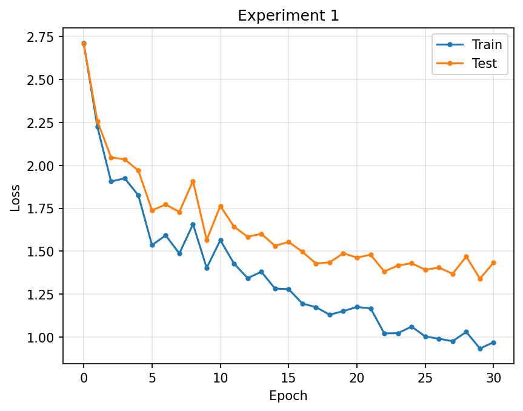</td>
    <td>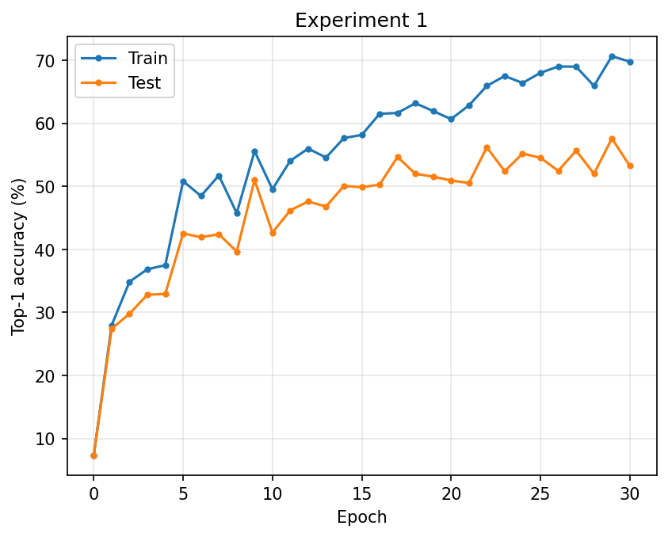</td>
    <td>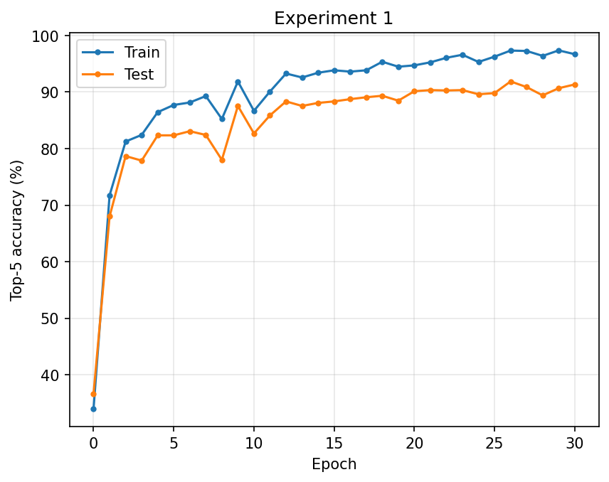</td>
  </tr>
</table>

### Experiment 2: conv1-3 + 3 FC

<table>
  <tr>
    <td align="center">Loss</td>
    <td align="center">Top-1 Accuracy</td>
    <td align="center">Top-5 Accuracy</td>
  </tr>
  <tr>
    <td>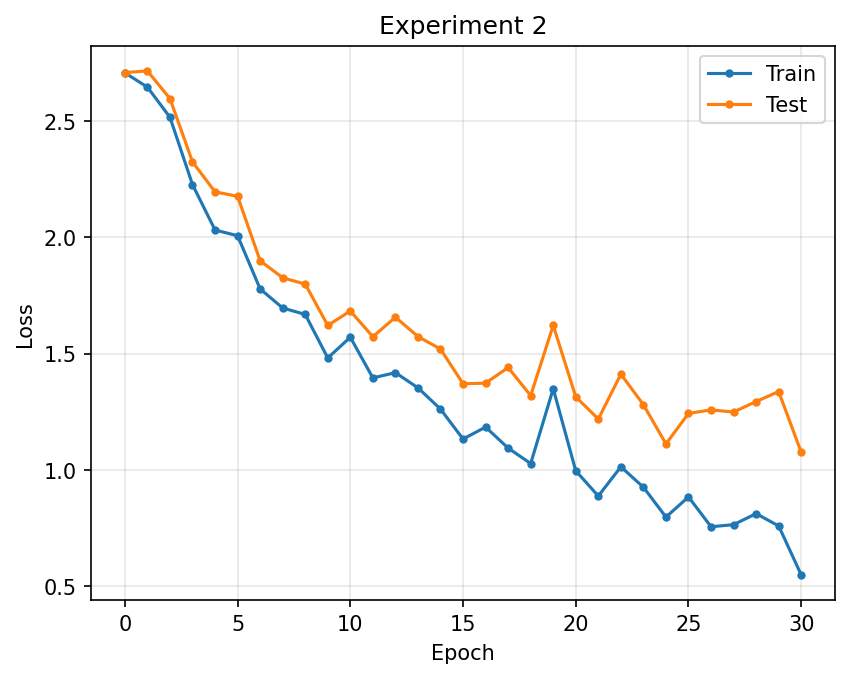</td>
    <td>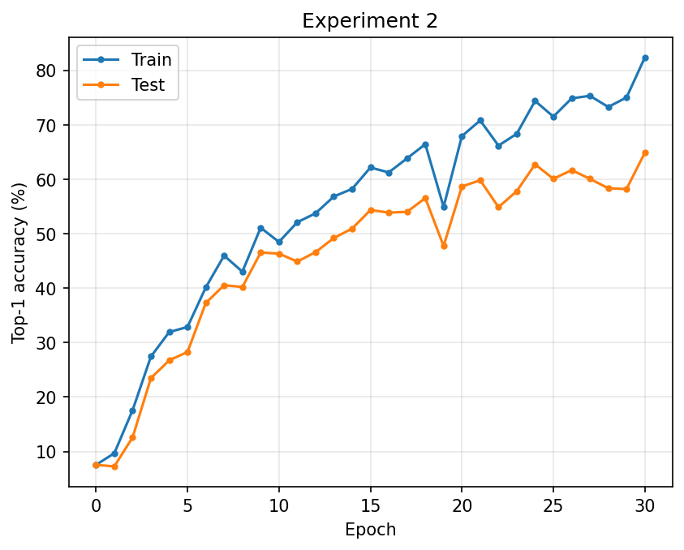</td>
    <td>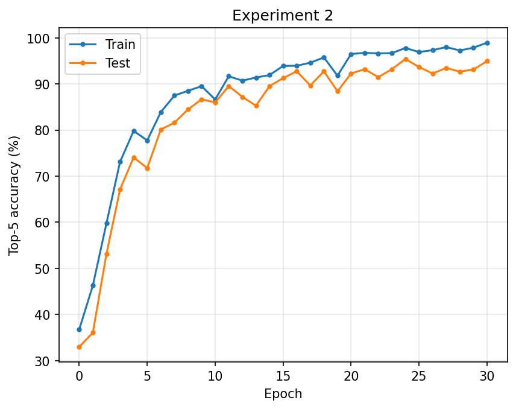</td>
  </tr>
</table>

### Experiment 3: Full AlexNet (random init)

<table>
  <tr>
    <td align="center">Loss</td>
    <td align="center">Top-1 Accuracy</td>
    <td align="center">Top-5 Accuracy</td>
  </tr>
  <tr>
    <td>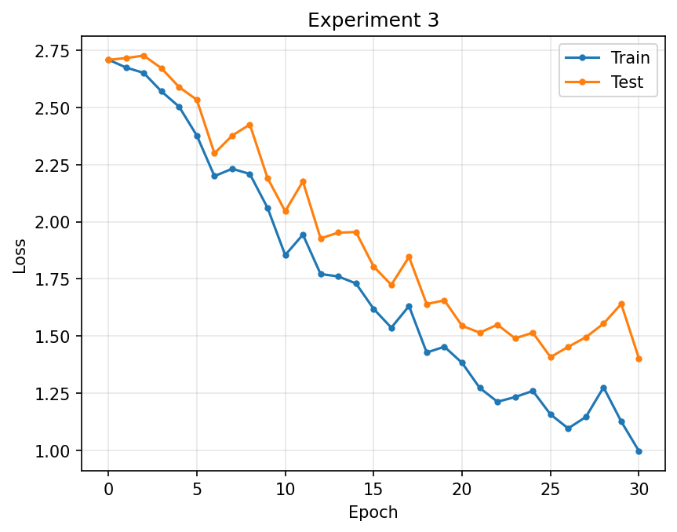</td>
    <td>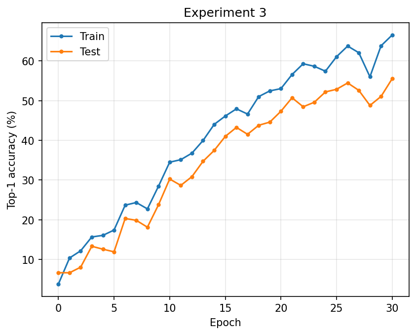</td>
    <td>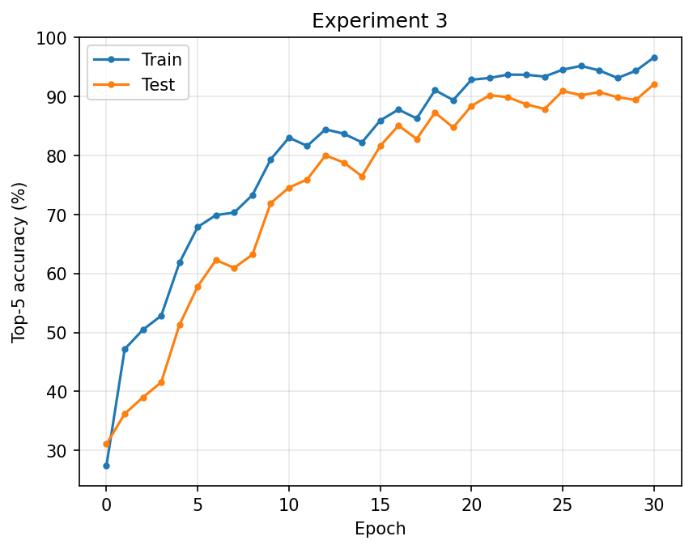</td>
  </tr>
</table>

### Experiment 4: Pretrained AlexNet, last layer only

<table>
  <tr>
    <td align="center">Loss</td>
    <td align="center">Top-1 Accuracy</td>
    <td align="center">Top-5 Accuracy</td>
  </tr>
  <tr>
    <td>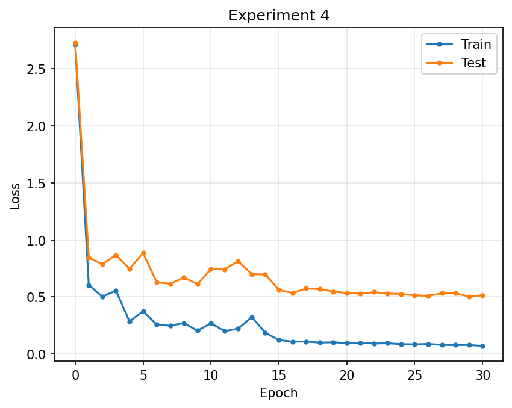</td>
    <td>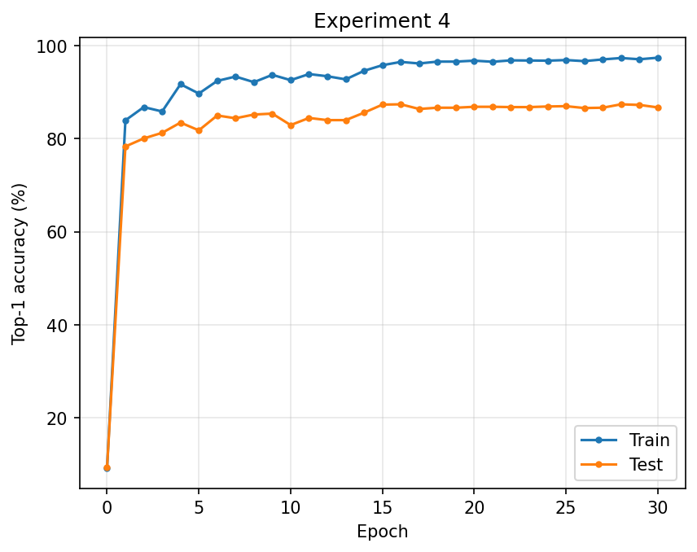</td>
    <td>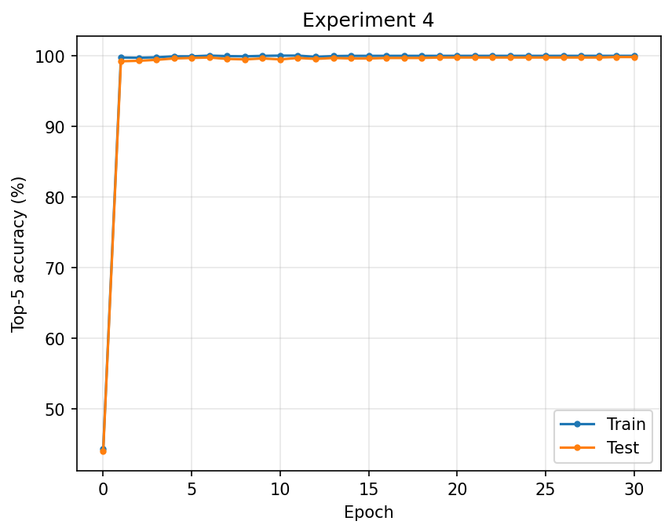</td>
  </tr>
</table>

### Experiment 5: Pretrained AlexNet, fine tuning

<table>
  <tr>
    <td align="center">Loss</td>
    <td align="center">Top-1 Accuracy</td>
    <td align="center">Top-5 Accuracy</td>
  </tr>
  <tr>
    <td>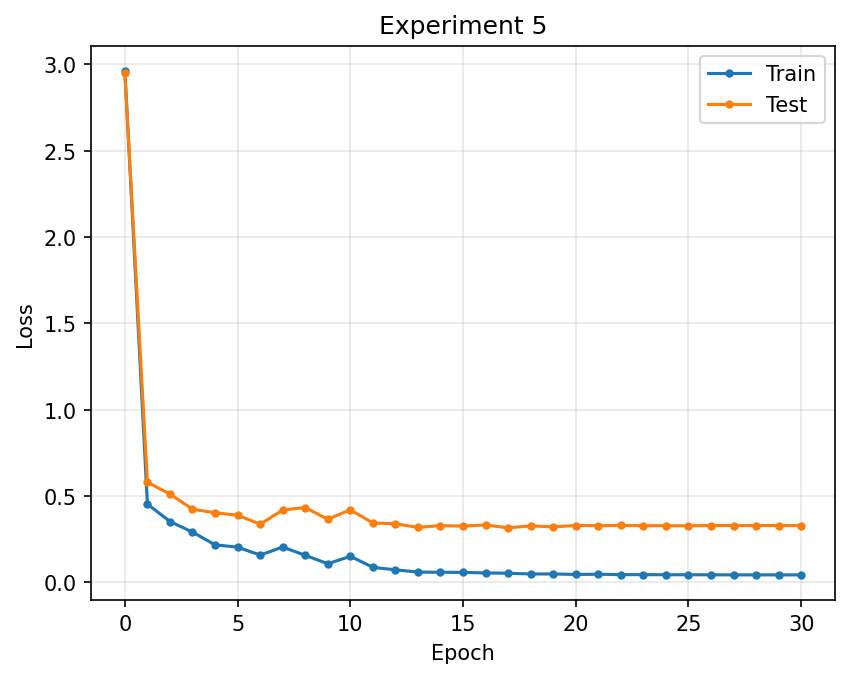</td>
    <td>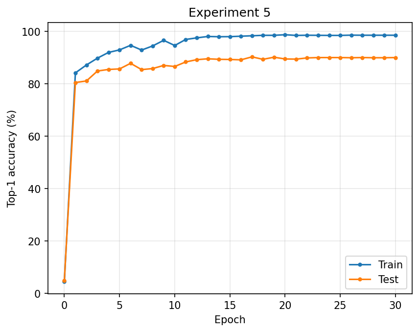</td>
    <td>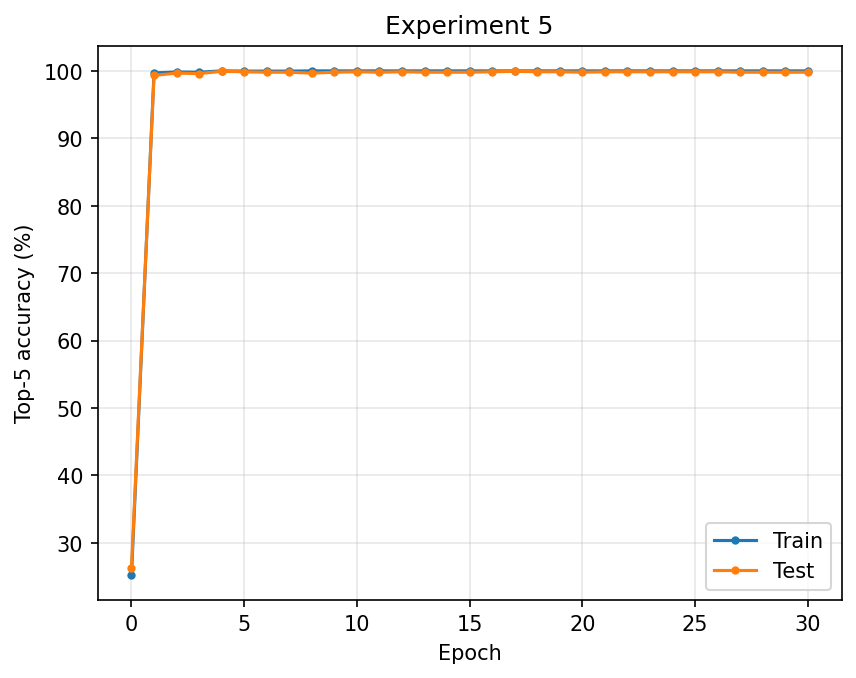</td>
  </tr>
</table>
