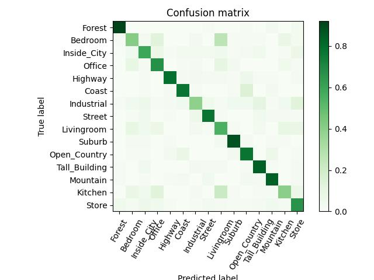

# Scene Recognition Using Bag of Words

This project performs scene recognition on [Scene-15-Raw dataset](https://www.kaggle.com/datasets/yiklunchow/scene15/versions/1) containing 15 different scene categories. Three different image representations and classification approaches are evaluated, starting with a simple pixel-based representation and progressing to a Bag of Visual Words (BoW) representation with k-NN and SVM classifiers.

## Methods

### 1. Simple Representation and Nearest Neighbor

Each image is converted to grayscale, resized to a fixed size, normalized, and flattened into a single feature vector. Test images are classified by comparing their vectors with the training images using L2 distance and the k-Nearest Neighbors (k-NN) method.

### 2. Bag of Words and k-NN

Dense SIFT features are extracted from the training images. All descriptors are clustered using k-means to create a visual vocabulary. Each image is then represented by a normalized histogram of visual words by assigning its SIFT descriptors to their nearest vocabulary centers. The resulting histograms are classified using k-NN.

### 3. Bag of Words and SVM

The same Bag of Visual Words representation from part 2 is used, but classification is performed using a Linear SVM instead of k-NN. A confusion matrix is also generated to visualize the classification performance across the 15 scene categories.

## Results

| Part   | Representation        | Classifier |         Accuracy |
| ------ | --------------------- | ---------- | ---------------: |
| Part 1 | Resized pixel vectors | k-NN       | **23.87%** |
| Part 2 | SIFT + Bag of Words   | k-NN       | **55.27%** |
| Part 3 | SIFT + Bag of Words   | Linear SVM | **71.80%** |

The results show a clear improvement when moving from raw pixel representations to local SIFT features and a Bag of Visual Words representation. The Linear SVM provides the best performance, achieving **71.80% accuracy**.

<table>
  <tr>
    <td></td>
  </tr>
</table>
