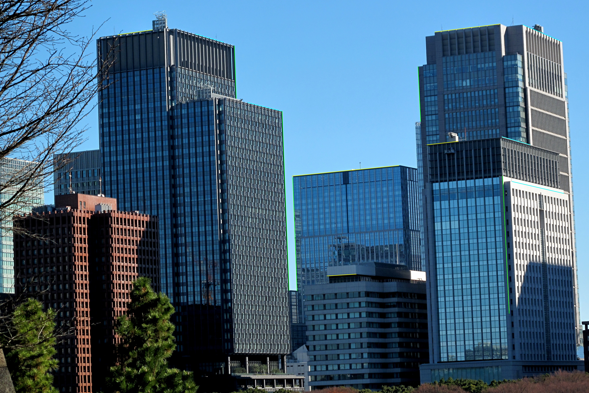
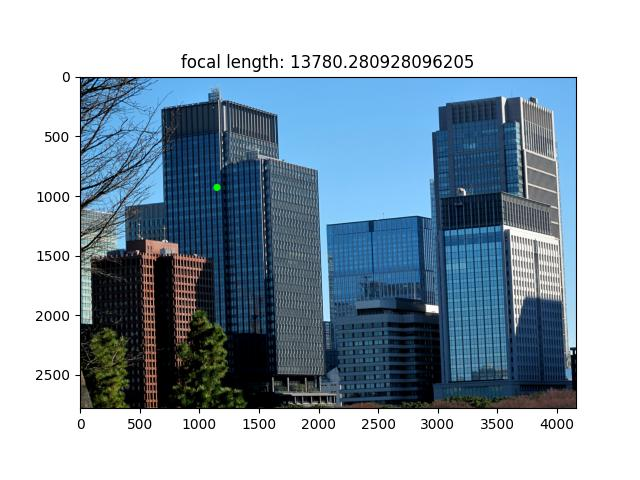

# Vanishing Points and Lines

This project estimates the vanishing points, horizon line, camera calibration parameters, and camera orientation from a single image. The estimated camera geometry is then used to rectify the image so that the camera becomes level with the ground.

## Method

First, several lines parallel to each of the three orthogonal scene directions are selected. Their intersections are used to estimate the vanishing points $(V_x)$, $(V_y)$, and $(V_z)$. For each direction, candidate line intersections are evaluated by their total distance to the selected lines, and the intersection with the smallest error is chosen. The horizon line is then obtained from the cross product of $(V_x)$ and $(V_y)$. Using the three vanishing points, the focal length and principal point are estimated, from which the camera calibration matrix and rotation matrix are computed. Finally, the rotation is converted into a homography, which is applied to the original image to produce the rectified result.

## Results

<table>
  <tr>
    <td align="center">Original Image</td>
    <td align="center">Selected Parallel Lines</td>
  </tr>
  <tr>
    <td></td>
    <td></td>
  </tr>
</table>

<table>
  <tr>
    <td align="center">Horizon Line Detection</td>
  </tr>
  <tr>
    <td></td>
  </tr>
</table>

<table>
  <tr>
    <td align="center">Vanishing Points Visualization</td>
  </tr>
  <tr>
    <td></td>
  </tr>
</table>

<table>
  <tr>
    <td align="center">Principal Point and Focal Length</td>
  </tr>
  <tr>
    <td></td>
  </tr>
</table>
